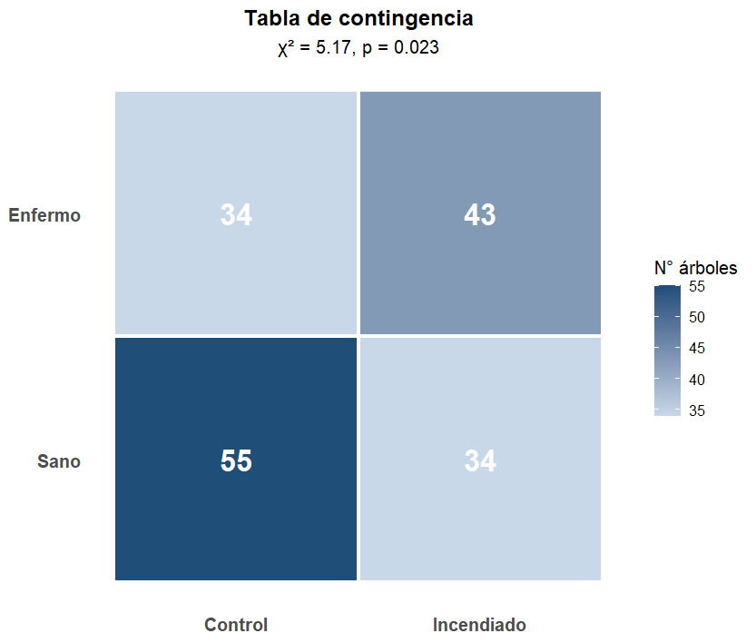
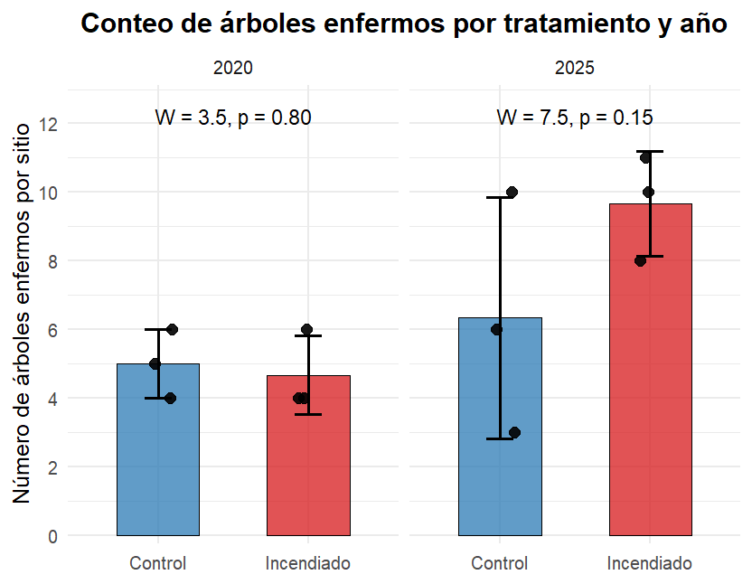
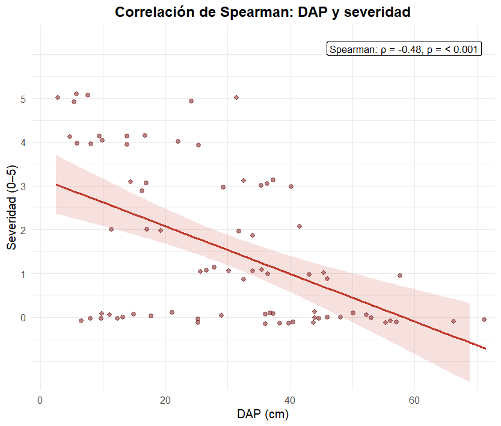
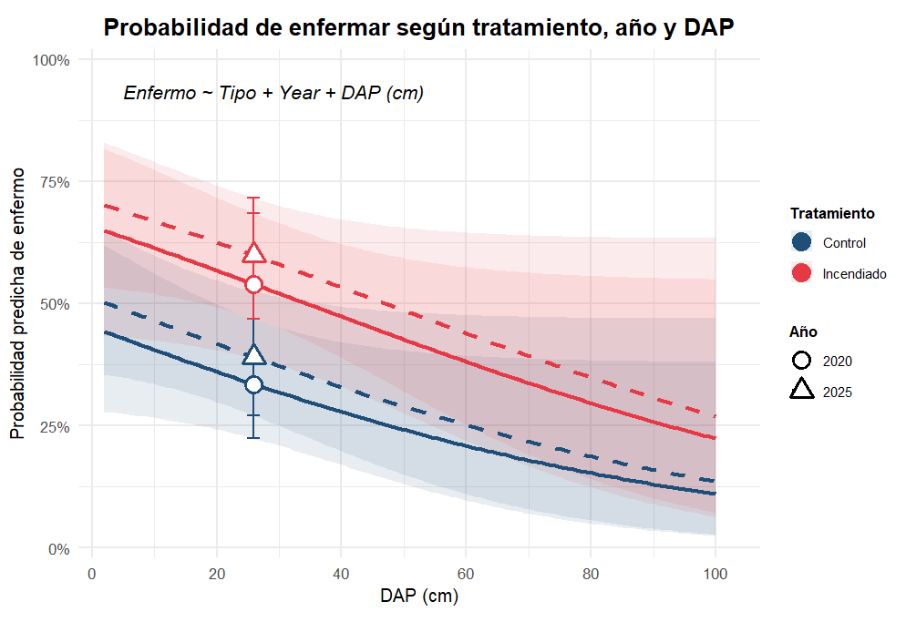

# Evaluación fitosanitaria de hongos en Pinaceae tras incendios en La Malinche, México

**Miguel Á. Hernández-Gutiérrez**¹,² · **Jorge Córtes-Flores**³\* · **Armando Navarrete-Segueda**⁴\* · **Leopoldo D. Vázquez-Reyes**⁵ · **Silvana Martínez-Rodríguez**¹

¹ Laboratorio Nacional de Análisis y Síntesis Ecológica, ENES Unidad Morelia, UNAM · ² Posgrado en Ciencias Biológicas, UNAM · ³ Jardín Botánico, Instituto de Biología, Sede Tlaxcala, UNAM · ⁴ Instituto de Investigaciones en Ecosistemas y Sustentabilidad, UNAM · ⁵ Facultad de Estudios Superiores Iztacala, UNAM


[**Abrir el sitio de GitHub pages **](https://migueangelhg.github.io/Monta-as-del-Centro-de-M-xico/)


---

## Resumen

Los incendios forestales son disturbios ecológicos naturales o antropogénicos, frecuentes en comunidades como el Bosque Templado de México. Sin embargo, su papel en la predisposición de árboles sobrevivientes a patologías fúngicas en la familia Pinaceae está poco documentado. Evaluamos el estado fitosanitario de árboles de Pinaceae en áreas quemadas y no quemadas con diferente tiempo transcurrido desde la quema (seis años, 2020; y un año, 2025) en el Área Natural Protegida **La Malinche**, México.

Se muestrearon **166 árboles** en **doce sitios** (seis por año, divididos en incendiados y control). Se registraron el diámetro a la altura del pecho (DAP), altura total, altura de la flama y severidad de la enfermedad. Los datos se analizaron mediante chi‑cuadrada, U de Mann‑Whitney, correlación de Spearman y regresión logística binomial en R.

**Resultados principales:**
- La incidencia de árboles enfermos fue mayor en sitios quemados (**55.8 %**) que en controles (**38.2 %**); χ² = 5.17, p = 0.023.
- El DAP mostró correlación negativa con la severidad en sitios incendiados (Spearman ρ = −0.48, p < 0.001).
- En el modelo logístico, los sitios quemados tuvieron mayor probabilidad de enfermar (**OR = 2.33**, IC 95 %: 1.21–4.50, p = 0.012); el DAP mostró un efecto protector marginal (OR = 0.981 por cm, p = 0.063); el tiempo desde el incendio no tuvo efecto (p = 0.471).

Estos hallazgos indican que los incendios predisponen a los pinos a enfermarse, mientras que diámetros mayores confieren resistencia parcial.

> **Palabras clave:** Bosques Templados · estrés post‑incendio · fisiología vegetal · mortalidad arbórea · patobioma · patógenos oportunistas · salud forestal · severidad.

---

## 1. Introducción

Los incendios forestales son disturbios ecológicos que ocurren de forma natural o inducida por causas antropogénicas, y son frecuentes en comunidades vegetales altamente estacionales como el Bosque Templado de México (Jardel‑Peláez et al., 2014). El género *Pinus* se encuentra adaptado a la exposición al fuego (yemas protegidas, germinación dependiente de fuego, corteza gruesa; Hood et al., 2026). Pese a ello, los árboles que sobreviven a incendios frecuentemente quedan en un estado de estrés fisiológico que los predispone a la infección por microorganismos, generalmente patógenos oportunistas (Solís‑García et al., 2021; Mageroy et al., 2023; Alfaro‑García et al., 2026).

La quema del tronco daña el cambium y la corteza, creando heridas y tejido necrótico que interrumpen el flujo de savia, reducen la capacidad fotosintética y agotan las reservas, debilitando el sistema inmune del árbol (Desprez‑Loustau et al., 2006). Estos eventos de estrés pueden desplazar relaciones benéficas previas y promover la transición de endófitos fúngicos residentes hacia especies patógenas (Bär et al., 2018).

Géneros como *Fusarium*, *Alternaria*, *Pestalotiopsis* y *Botryosphaeria* han sido reportados como componentes comunes de la micobiota endófita y epífita de los pinos mexicanos, con la facultad de comportarse como patógenos cuando las condiciones del hospedero se deterioran (Marmolejo‑Monciváis et al., 2013). También se tiene registro de *Armillaria mellea* en bosques de pino‑encino (Valdés et al., 2004) y de mortalidad de *Pinus hartwegii* posterior a quemas prescritas (Rodríguez‑Trejo et al., 2007).

En este contexto, el presente estudio evalúa la condición fitosanitaria de árboles de Pinaceae en sitios quemados y no quemados, para dos tiempos de exposición (2020 y 2025), con énfasis en hongos patógenos y en la relación de su incidencia y severidad con variables como el DAP.

---

## 2. Métodos

### 2.1 Sitio de estudio

El trabajo se realizó en el **Área Natural Protegida La Malinche**, ubicada en el Eje Neovolcánico Transversal, en el estado de Tlaxcala, México (Figura 1). La región alberga bosques templados dominados por pinos y presenta una historia de manejo y disturbios que han moldeado su estructura actual (Villers‑Ruiz & López‑Blanco, 2004).


*Figura 1.* Área de estudio y puntos de muestreo localizados en el ANP La Malinche (Tlaxcala, México). Los puntos rojos representan sitios de muestreo con incendio previo; en azul, los controles. Se distingue entre los años 2020 y 2025 [**Abrir mapa interactivo en pantalla completa**](https://migueangelhg.github.io/Monta-as-del-Centro-de-M-xico/malinche_incendios_2020_2025.html).

### 2.2 Muestreo

Se trabajó en la ladera occidental del volcán. Se seleccionaron **doce sitios**: seis correspondientes a áreas quemadas y seis a controles (no quemadas), divididos en dos ventanas temporales —tres pares con evento de fuego hace seis años (2020) y tres pares con un año de exposición (2025)—.

En cada sitio se aplicó un **transecto dirigido de 50 × 2 m** en la zona de mayor densidad forestal, registrando:

- Diámetro a la altura del pecho (DAP)
- Altura total
- Severidad de la enfermedad (escala 0–5; 0 = sin daño, 5 = árbol muerto)
- Presencia de otros patógenos
- Altura de la llama en la corteza (solo en zonas quemadas)

### 2.3 Procesamiento de datos

Con fines de replicabilidad, las bases de datos y el código se encuentran depositados en este repositorio de GitHub. Los polígonos de incendio (2020–2025) se obtuvieron de la **Infraestructura de Datos Espaciales Forestales (IDEFOR)** (https://idefor.cnf.gob.mx/mviewer/incendios). Para cada polígono se calcularon centroides y se delimitaron controles; posteriormente se filtraron considerando los efectos a corto y mediano plazo del estrés post‑incendio.

Los análisis se realizaron en **R** (R Core Team, 2026), aplicando:

- Prueba de independencia **chi‑cuadrada**
- Prueba **U de Mann‑Whitney**
- Correlación de **Spearman**
- **Regresión logística binomial**

---

## 3. Resultados

Se muestrearon **166 árboles** de la familia Pinaceae (89 en sitios control y 77 en sitios incendiados), identificando al menos tres especies: *Pinus pseudostrobus*, *Pinus montezumae* y *Abies religiosa*, así como lesiones provocadas por hongos (*Caliciopsis* spp., *Fusarium circinatum*, *Cronartium* sp., *Diplodia sapinea* y *Skeletocutis alutacea*; Figura 2 del manuscrito).

### 3.1 Incidencia de la enfermedad

La tabla de contingencia mostró que el número de individuos enfermos fue significativamente mayor en sitios incendiados (**55.8 %**) frente a controles (**38.2 %**) (Figura 3). La asociación fue estadísticamente significativa (χ² = 5.17, gl = 1, p = 0.023).



*Figura 3.* Tabla de contingencia en formato heatmap del estado fitosanitario de los árboles (enfermos vs. sanos). La intensidad del azul indica la frecuencia absoluta por celda; la anotación superior presenta el resultado de la prueba chi‑cuadrada.

### 3.2 Conteo de árboles enfermos por sitio

Al aplicar la prueba U de Mann‑Whitney al conteo de árboles enfermos por sitio no se encontraron diferencias significativas entre sitios incendiados y controles en 2020 (W = 3.5, p = 0.80) ni en 2025 (W = 7.5, p = 0.15) (Figura 4).



*Figura 4.* Conteo de árboles enfermos por sitio en áreas incendiadas y controles durante 2020 y 2025. Las barras representan la media ± DE; los puntos negros indican los valores individuales por sitio (n = 3 por grupo). Las etiquetas superiores muestran el estadístico W de la prueba U de Mann‑Whitney unilateral.

### 3.3 Relación DAP–severidad

El DAP mostró una correlación negativa altamente significativa al restringir el análisis a los sitios incendiados (ρ = −0.48, p < 0.001, n = 77) (Figura 5).



*Figura 5.* Relación entre el DAP (cm) y la severidad de la enfermedad (escala 0–5) en sitios incendiados. Los puntos representan árboles individuales (n = 77); la línea roja es el ajuste lineal y la banda sombreada el IC al 95 %.

### 3.4 Modelo de regresión logística binomial

El modelo (Figura 6) indica que los árboles en sitios incendiados tuvieron aproximadamente el doble de probabilidades (odds) de presentar enfermedad en comparación con los controles, controlando por año y DAP (**OR = 2.33**, IC 95 %: 1.21–4.50, p = 0.012). El DAP mostró un efecto protector marginalmente significativo (OR = 0.981 por cm, IC 95 %: 0.962–1.001, p = 0.063). La interacción Tratamiento × Año no fue significativa (χ² = 0.19, gl = 1, p = 0.664), lo que indica que el efecto del incendio fue consistente entre los dos tiempos de exposición.

En los controles, el DAP tuvo un efecto nulo sobre la probabilidad de enfermar (OR = 0.996, p = 0.745), mientras que en los sitios incendiados el efecto fue negativo (OR = 0.959 por cm), sugiriendo que el efecto protector del diámetro se manifiesta principalmente bajo condiciones de incendio.



*Figura 6.* Probabilidad predicha de presencia de enfermedad (Severidad > 0) en función del DAP, según tratamiento (Incendiado vs. Control) y año (2020 vs. 2025). Las curvas representan las estimaciones del modelo logístico binomial; las bandas sombreadas indican el IC al 95 %. Los puntos con barras de error verticales representan la probabilidad predicha y su IC 95 % en el DAP promedio.

---

## 4. Discusión

Los resultados indican que los incendios forestales actúan como un factor de estrés que predispone a los árboles de Pinaceae a la infección por hongos patógenos, potencialmente oportunistas. La mayor incidencia de individuos enfermos en sitios quemados (respaldada por el modelo logístico, OR = 2.33, p = 0.012) es consistente con la evidencia de que el fuego altera la fisiología del árbol y facilita la infección (Mageroy et al., 2023). El daño térmico en el tronco genera heridas y tejido necrótico, reduce las reservas energéticas y la capacidad fotosintética, debilitando el sistema inmune (Desprez‑Loustau et al., 2006; Bär et al., 2018).

El **DAP emergió como un factor protector crucial**, especialmente en sitios incendiados (ρ = −0.48, p < 0.001). Esto puede explicarse porque los árboles de mayor diámetro poseen corteza más gruesa que actúa como aislante térmico del cambium (Rodríguez‑Trejo et al., 2007; Espinosa et al., 2020; Güney et al., 2024).

Un mecanismo clave es la capacidad de ciertos hongos para transitar de una vida endófita comensal a un estado patógeno cuando el hospedero se estresa (Solís‑García et al., 2021). Este es el caso de *Diplodia sapinea*, patógeno oportunista que coloniza los pinos como endófito sin causar síntomas y se vuelve virulento tras eventos de estrés como sequía o calor (Brodde et al., 2019; Slippers & Wingfield, 2007; Stanosz et al., 2001). El fuego no solo puede desencadenar esta transición, sino también reestructurar el microbioma arbóreo (Huang et al., 2016), facilitando la dominancia de ciertas especies y desencadenando actividad patógena.

Nuestro estudio **no encontró evidencia de que el tiempo transcurrido desde el incendio** (seis años en 2020 vs. un año en 2025) modifique la incidencia de la enfermedad (p = 0.471). Una posible explicación biológica es que las infecciones fúngicas post‑incendio se vuelvan crónicas o que los patógenos oportunistas colonicen el tejido dañado poco después del evento y persistan durante años mientras el árbol no logre compartimentar completamente el daño (Filip & Yang‑Erve, 1997). La falta de significancia en la prueba U de Mann‑Whitney a nivel de sitio probablemente refleja la baja potencia estadística derivada del reducido número de réplicas independientes (n = 3 por tratamiento/año), un desafío común en estudios ecológicos con diseños jerárquicos.

---

## 5. Conclusiones

Al menos para una parte de la familia Pinaceae, los incendios en La Malinche actúan como un factor de estrés que **aumenta la incidencia de árboles enfermos**, elevando la probabilidad de encontrar individuos enfermos en sitios donde se registraron siniestros. Es indispensable:

- Ampliar y mejorar el diseño de muestreo.
- Realizar identificación molecular de los patógenos para confirmar la presencia real de especies.
- Cultivar y aislar hongos provenientes de órganos dañados y sanos de las plantas hospederas.

---

##  Estructura del repositorio

| Archivo / Carpeta | Descripción |
| :--- | :--- |
| `AnálisisdedatosMCM.R` | Script principal de análisis estadístico y espacial. |
| `DwnCapasanualesMapaInteractivo.R` | Descarga de capas de incendios (IDEFOR/WFS) y generación del mapa interactivo. |
| `BorradorMapaInteractivo.R` | Borrador del mapa interactivo (HTML) de polígonos y sitios. |
| `MapaInteractivoFinal.R` |Mapa interactivo (HTML) con polígonos de incendio, sitios control y de muestreo. |
| `TablasdeResultados.R` | Rutinas para la generación de tablas resumen. |
| `DatosEMCM.csv` | Datos crudos del estudio (166 árboles). |
| `sitios_y_controles_coordenadas.csv` | Coordenadas geográficas de sitios de muestreo y controles. |
| `gadm/` | Capas geoespaciales base (límites administrativos de México). |
| `figuras/` | Resultados finales en formato de imagen (Figuras 1, 3, 4, 5 y 6 del manuscrito). |
| `sitioGithubpages/` | (https://migueangelhg.github.io/Monta-as-del-Centro-de-M-xico/)
 |

---

##  Reproducibilidad

1. Clona el repositorio:

   ```bash
   git clone https://github.com/migueangelhg/Monta-as-del-Centro-de-M-xico.git
